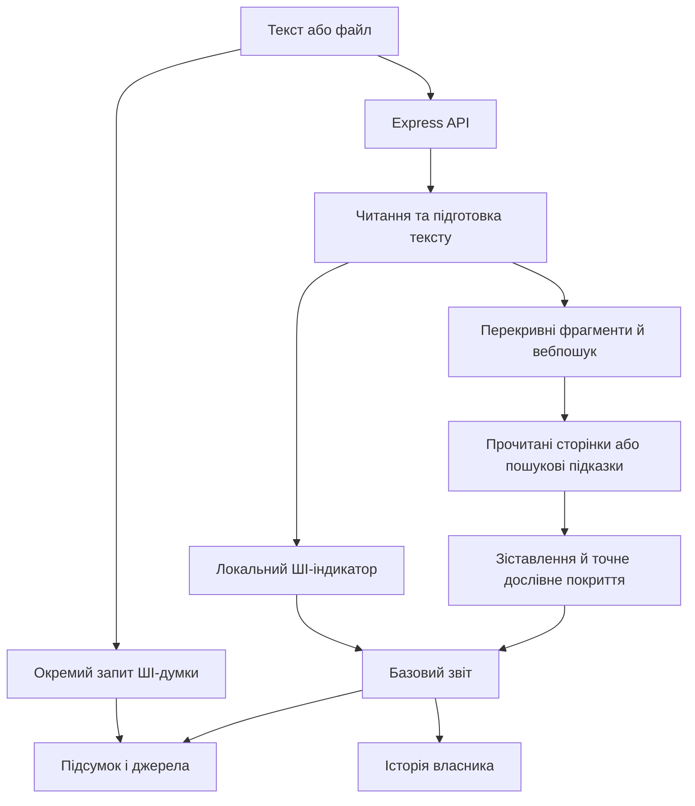

# Архітектура «Незбіг»

Документ описує реалізацію станом на 16 жовтня 2026 року. Історичні плани в `docs/superpowers/plans` не є специфікацією поточної поведінки.

## Компоненти

| Частина | Реалізація | Відповідальність |
| --- | --- | --- |
| Клієнт | React 19, TypeScript, Vite, React Router | редактор, файли, прогрес, результати, історія, експорт |
| API | Express 5, Zod, Multer | валідація, завдання, аналіз, облікові записи |
| Читання документів | Mammoth, pdf-parse, JSZip | текст і доступне форматування DOCX/PDF |
| Пошук | `webSearch.ts` | запити, провайдери, читання сторінок, діагностика |
| Зіставлення | `plagiarismScoring.ts`, `matchCoverage.ts`, `reportMatches.ts` | сила збігу, точні інтервали, відбір доказів |
| ШІ | `aiDetection.ts`, `aiStylometry.ts`, `aiTextPreprocess.ts` | локальні ознаки та оцінка надійності |
| ШІ-думка | `llmOpinion.ts`, `llmShared.ts`, адаптери NIM/OpenRouter | окрема необов'язкова оцінка |
| Зберігання | `db.ts`, `auth.ts`, `jobStore.ts`, `searchCache.ts` | власники, історія, завдання, кеші |



## Підготовка тексту

Файловий сервер приймає до 50 MiB, але платформа розгортання може мати менший ліміт запиту. Підтримуються TXT, MD/Markdown, CSV, JSON, RTF, DOCX і PDF. PDF обробляється через текстовий шар, без OCR.

`proseFilter.ts` видаляє розпізнані блоки й фрагменти коду та зберігає межі рядків і абзаців. `documentPreprocess.ts` окремо шукає службову титульну частину. Для її пропуску потрібні щонайменше два інституційні маркери й початок основного тексту.

Бібліографічний хвіст видаляється лише після розпізнаного заголовка в останніх 65% документа. Заголовок має стояти окремим рядком; для сплощеного PDF-тексту потрібні ознаки нумерованого списку з роком. Згадка слова `references` або фрази «список джерел» у реченні не є достатньою. Додатки автоматично не прирівнюються до бібліографії. Це евристика: кількість виключених слів показується у звіті й потребує контролю.

ШІ-препроцесор додатково виключає довгі цитати, бібліографію та нейтралізує inline URL/DOI й числові цитування. Обсяг для ШІ може відрізнятися від обсягу для вебзіставлення. Препроцесори не змінюють початковий файл.

## Пошук джерел

Документ розбивається на перекривні фрагменти з координатами `startWord`. Налаштування повного проходу забезпечують включення кінця документа. Для довгих документів зменшується кількість запитів на фрагмент і застосовується двофазне дочитування сторінок.

Запити беруть послідовні фрази з початку й середини фрагмента, точну інформативну фразу та ключові слова. Реальна кількість обмежується режимом і довжиною документа.

| Провайдер | Підключення |
| --- | --- |
| DuckDuckGo | HTML/резервні способи; опційний `SEARXNG_URL` |
| Wikipedia, Crossref | базові публічні запити |
| Semantic Scholar, OpenAlex | академічний пошук, залежно від профілю й довжини документа |
| Serper, Tavily, Brave | відповідний API-ключ |
| Google Custom Search | `GOOGLE_SEARCH_API_KEY` і `GOOGLE_SEARCH_ENGINE_ID` |

Змінна `OPENALEX_API_KEY` зараз не використовується адаптером. Наявність змінної в старому налаштуванні не означає, що запит її використовує.

Результати змішуються між провайдерами, дедуплікуються та обмежуються перед читанням сторінок. Черга допускає до 4 одночасних задач одного провайдера. Після 3 помилок circuit breaker призупиняє його на 45 секунд. Типовий timeout пошуку — 8 секунд, читання сторінки — 7,5 секунди.

HTTP-помилка публічних API більше не маскується як успішний порожній результат. Діагностика розрізняє підтверджену квоту, доступ API, timeout і недоступність. Деякі резервні способи DuckDuckGo мають власну поведінку відновлення; повідомлення про успіх не гарантує повноти індексу.

## Сила збігу та покриття

Для порівняння використовуються токени, 2/3/4-грамні послідовності, longest common run, winnowing і локальний full-text index. Поточна базова формула:

```text
baseScore = 100 × pageBonus × (
  0.24 × wordOverlap +
  0.20 × fullTextRank +
  0.22 × phraseScore +
  0.20 × runScore +
  0.14 × fingerprintOverlap
)
```

`phraseScore` поєднує 2/3-грами й 4-грамний перетин; winnowing використовує 4-грами та вікно 4. Додаткові правила обмежують boilerplate і підсилюють довгі дослівні послідовності. Тому формула не є простою середньою всіх відсотків.

`confidence: page` означає достатній доступний текст джерела, а не підтверджений факт плагіату. Академічні API також можуть надавати текст анотації. Snippet не входить до підтвердженої сили або дослівного покриття. Для тієї самої URL і фрагмента прочитане джерело замінює snippet, навіть якщо воно спростовує попередню сильну підказку.

`plagiarismScore` — максимум сили серед підтверджених прийнятних збігів. `matchedTextPercent` обчислюється окремо: точні дев'ятислівні вікна перетворюються на інтервали, перетини об'єднуються, кількість слів ділиться на обсяг підготовленого документа. Стандартні академічні шаблони можуть бути виключені. Покриття не вимірює перефразування або невідомі джерела.

До обчислення покриття входять усі прийнятні підтверджені збіги. У `matches` зберігаються до 24 найсильніших записів, спочатку підтверджені. `matchesTotal` повідомляє загальну кількість записів, а `verifiedSourcesTotal` — кількість унікальних підтверджених URL. Це різні величини: одна сторінка може відповідати кільком фрагментам.

## Локальний ШІ-аналіз

Модуль аналізує словник, повтори, ритм, мовні конструкції та перекривні вікна по 220 слів із перекриттям 55 слів. Для довгого тексту використовує оцінку документа, медіану, верхній квартиль, найсильніші вікна й частку вікон з ознаками. Ваги каналів: статистичний 0,38; патерни 0,42; структура 0,20.

Джерела, посилання, форматування, пунктуація, безособовий стиль, рівномірність абзаців і стандартна мета дослідження не повинні визначати авторство. Контекстні сигнали категорії `safeguard` виключені з оцінювальних каналів, бонусів за кількість доказів і списку підозрілих ознак сегмента.

Звичайне «я не можу» не є самовизначенням ШІ. Слова «як» і «правило» не вважаються самостійними hedge-маркерами. Пошук лексичних патернів має Unicode-межі, щоб не знаходити ключове слово всередині іншого слова.

Нижче 80 аналізованих токенів повертається `insufficient`; для обмежено підтримуваної мови — `uncertain`. Надійність враховує обсяг, кількість вікон, узгодженість і сигнали, але також є евристикою. Перекривні вікна й споріднені лексичні/ритмічні ознаки не є статистично незалежними.

Поля з історичними назвами `aiProbability` і `supportedPercent` не слід інтерпретувати як калібровану ймовірність авторства чи виміряну точність для мови.

## Окрема ШІ-думка

Базовий звіт не чекає на модель. Додатковий запит використовує NVIDIA NIM, потім OpenRouter із резервними моделями. Вибірка авторського тексту обмежена приблизно 6000 символами й може включати підозрілі уривки. Локальні оцінки передаються як контекст, без `safeguard`-ознак.

Обидві моделі отримують вимогу нейтральності щодо джерел, оформлення, займенників, помилок і академічного жанру. Це інструкція, а не гарантія виконання. Відповідь моделі зберігається окремо та не замінює локальний індикатор чи відсоток збігів.

## UI та експорт

Порядок: назва й дії → ШІ-індикатор і ШІ-думка / дослівне покриття → переходи до розділів → джерела → пояснення моделі → розширений локальний аналіз. Джерела відкриті за замовчуванням; спочатку видно 6 записів, решта доступні кнопкою. Вкладки перемикають джерела, підозрілі фрагменти й технічні відомості; стан вкладки відображається в URL.

ШІ-пояснення та його надійність відкриті без disclosure. Пошукові підказки відокремлені від підтверджених джерел. При збоях пошуку нуль не подається як доказ унікальності. Експорт PNG очікує завершення створення зображення; помилки видимі користувачу. PDF/PNG — стислий виклад із першими 5 джерелами; JSON містить дані звіту.

## Облікові записи та сховище

HTTP-only cookie містить підписану сесію з audience; production використовує Secure cookie і стабільний випадковий JWT-секрет. OAuth має перевірку state, прив'язку до браузера та дозволених origin. Google Drive використовує окремий `drive.file`-доступ і не тотожний сесії застосунку. Access token зберігається лише в пам'яті сторінки, очищається при виході; старі localStorage-копії видаляються при зверненні до токена.

Звіти читаються/змінюються лише власником. Імпорт отримує новий серверний ID. Видалення перевіряється й поширюється на налаштовані копії; пізня відповідь моделі не повинна відновлювати видалений звіт.

Redis має пріоритет для звітів і користувачів; KV REST підтримує звіти/кеші, але не замінює Redis для всіх шляхів користувацьких даних. Локальний fallback використовує файли й потребує постійного тому. Пошукові/page/job кеші `DistributedCache` розподіляються через KV REST; `REDIS_URL` сам по собі не вмикає їх розподіл.

Пошуковий кеш — 30 хвилин, кеш тексту сторінок — 1 година; account jobs і гостьові завдання — до 30 хвилин. Результатні кеші прив'язані до користувача/гостьового cookie, входу, параметрів і версії алгоритму. Redis/KV-звіти мають TTL 30 днів; файлові — до видалення. У звіті може бути до 100 000 символів початкового тексту.

## Перевірка й межі висновків

Vitest перевіряє алгоритми, доступ до звітів, сховище, клієнтські стани й помилки. Пошукові/LLM-запити в тестах підмінені. `npm run calibrate` запускає малий синтетичний корпус; він не підтверджує реальну точність, відсутність упереджень або наукову калібровку.

Повний перелік останніх виправлень і перевірок — у [звіті перегляду](REVIEW_2026-10-16.md). Для запуску production див. [Vercel](VERCEL_UA.md).
